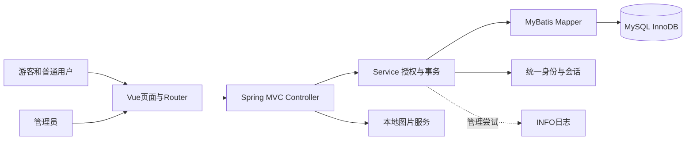

# 寻爪系统架构设计

## 1 架构目标与质量驱动
系统采用分层模块化单体，为账号治理、领养交接和商城履约提供统一身份、数据和事务环境。设计重点是可运行交付、权限边界、重复操作、并发结果和金额解释性，避免为课程规模引入分布式协调成本。

## 2 技术与职责
| 组件 | 版本或配置 | 职责 |
|---|---|---|
| Java / Spring Boot | 17 / 4.1.2 | Web MVC、服务生命周期和事务管理 |
| MyBatis | 4.0.0 | 参数绑定与Mapper数据访问 |
| MySQL | 8，实测8.0.45，InnoDB | 外键、唯一约束、行锁和持久化 |
| Vue / Router / Pinia | 3.5.45 / 4.6.4 / 3.0.4 | 页面、导航和内存会话状态 |
| Vite / plugin-vue | 8.3.8 / 6.0.10 | 开发代理与生产资源构建 |
| Node / Python | 实测Node24.15.0；Python3标准库 | 前端构建与本地管理/测试脚本 |

Controller只处理参数和响应；Service拥有业务状态、对象归属与事务；Mapper只负责持久化，不决定谁能操作。前后端校验互补，服务端为最终依据。

## 3 模块和数据所有权
| 模块 | 主要类或目录 | 所属数据 | 规则 |
|---|---|---|---|
| 身份与资料 | identity、web/MeController | e4_user、e4_session | 其他模块只引用用户ID并消费身份服务 |
| 平台管理 | administration | e4_command及账号处置 | 状态、通知、命令结果同事务 |
| 通知 | notification | e4_notification | 本人读取和显式已读 |
| 领养 | adoption | pet、adoption_application、adoption_result | 宠物行协调当前轮次 |
| 商城 | shop | product、cart_item、shipping_address、shop_order、order_item | 价格、快照、库存和履约统一服务 |
| 图片 | media | .local/uploads与静态资源 | 格式、大小及像素限制 |

## 4 架构决策记录

### ADR-001 模块化单体与MVC分层

**关联需求：** FR-01—21；NFR-05。

**问题与约束：** 账号、领养与商城需要共享身份、状态和事务边界，且评审必须能按README启动。

**采用方案：** 采用Spring Boot单体，Controller解析请求与返回DTO，Service承担权限、业务编排和事务，MyBatis Mapper只负责持久化。前台与后台共用同一业务服务。

**被否决的备选：** 保留不同后端作为多个独立服务，或让Controller直接调用SQL完成流程。

**否决理由：** 前者增加认证和跨服务协调成本，后者让同一业务在不同入口重复实现，容易漏掉权限与回滚。

**后果与代价：** 部署简单、事务明确，但单体仍需要按identity、adoption、shop等领域维护边界，不能形成无归属的大类。

**验证依据：** 生产包构建、实际启动和浏览器闭环，证据production-build.txt。 结果范围见`evidence/verification.md`，技术验证与最终人工验收分别记录。

### ADR-002 数据库会话与固定角色

**关联需求：** FR-01—05；NFR-01。

**问题与约束：** 退出、改密及冻结必须使相应旧登录状态失效，普通用户不得通过请求提权。

**采用方案：** USER/ADMIN固定角色，受控离线创建ADMIN；随机Bearer仅保存摘要，会话绑定账号版本，绝对30分钟有效。前端仅内存保存。

**被否决的备选：** 纯无状态JWT、仅前端路由守卫、单一共享演示身份。

**否决理由：** 单靠到期不能满足即时撤销；页面入口不能拦截直接接口；共享身份不能保护本人订单与地址。

**后果与代价：** 每次受保护请求需要数据库核验，刷新重登是明确体验代价；不使用凭据正向缓存。

**验证依据：** 角色注入、退出/冻结/改密撤销及解冻不恢复测试。 结果范围见`evidence/verification.md`，技术验证与最终人工验收分别记录。

### ADR-003 事务与统一加锁顺序

**关联需求：** NFR-01—03。

**问题与约束：** 账号冻结、业务写入、库存扣减和结果保存可能发生竞争。

**采用方案：** IdentityService在事务内锁账号与会话并复核状态；业务再锁宠物，或订单及商品ID升序行，持有至提交。多表状态共同生效。

**被否决的备选：** 仅请求开始鉴权、仅JVM synchronized、业务更新后再异步补关键记录。

**否决理由：** 入口检查留下在途窗口，JVM锁不能约束不同连接，异步补偿不能保证成功响应时记录完整。

**后果与代价：** 局部串行化增加等待，必须维持固定锁序并控制事务长度；外部文件和INFO日志不作为业务事务提交依据。

**验证依据：** 真实HTTP并发及MySQL结果查询；失败多商品无部分扣减。 结果范围见`evidence/verification.md`，技术验证与最终人工验收分别记录。

### ADR-004 领养交接协调与唯一结果

**关联需求：** FR-09—12；NFR-02。

**问题与约束：** 多人申请、并发选定、重复成功确认以及成功失败竞争必须指向同一轮次。

**采用方案：** 以宠物行协调申请状态，用申请ID标识当前轮次；分别记录双方确认；成功结果以pet_id为主键，失败保留历史并恢复招领。

**被否决的备选：** 仅领养人确认完成、只靠按钮禁用、把失败申请物理删除。

**否决理由：** 无法证明双方认可；直接请求可绕过按钮；删除历史使延迟请求和后续轮次难以区分。

**后果与代价：** 交接流程需要两名当事人操作，平台不自动替任何一方确认；成功后不提供重新挂牌。

**验证依据：** 并发选定、单方重放、双方确认、失败恢复、旧请求隔离。 结果范围见`evidence/verification.md`，技术验证与最终人工验收分别记录。

### ADR-005 付款时整单扣减库存

**关联需求：** FR-14、15、19—21；NFR-03。

**问题与约束：** 购物车、下单、付款和运营改库存都可能同时操作同一商品。

**采用方案：** 购物车与待付款不预占；付款锁订单和升序商品，先全单检查，再扣减并置PAID。商品版本在扣减时递增，旧运营编辑拒绝覆盖。

**被否决的备选：** 无库存限制、下单即预占并引入超时释放、按商品部分扣款成功。

**否决理由：** 无库存会接受超量订单；预占需额外释放机制；部分成功无法解释一单总额和状态。

**后果与代价：** 待付款不保证最终有货，付款可能因缺货失败；需明确提示对应商品。

**验证依据：** 最后一件竞争、重复付款、多商品失败、付款取消竞争及旧库存版本测试。 结果范围见`evidence/verification.md`，技术验证与最终人工验收分别记录。

### ADR-006 整数分与不可变订单快照

**关联需求：** FR-16—18；NFR-04。

**问题与约束：** 浮点、前端报价、后续商品改价与地址编辑可能改变用户已确认内容。

**采用方案：** 所有金额整数分；服务端唯一优惠函数；报价标识绑定选中商品与地址版本；订单独立保存商品、金额及收货快照。

**被否决的备选：** 二进制浮点累计、客户端应付金额、订单直接引用可变地址内容。

**否决理由：** 舍入不一致、可篡改金额和历史收货信息漂移会破坏订单解释性。

**后果与代价：** 报价过期必须重新核对，不能静默替换新金额；快照会保留必要的冗余字段。

**验证依据：** PricingTest、未勾选排除、报价版本与地址变更用例。 结果范围见`evidence/verification.md`，技术验证与最终人工验收分别记录。

### ADR-007 模拟付款与人工履约

**关联需求：** FR-19—21；NFR-05。

**问题与约束：** 课程需要演示成功、失败、库存不足和收货结果，同时避免外部资金与物流成为依赖。

**采用方案：** 付款显式选择模拟成功/失败；成功仍须库存验证。ADMIN录入承运方和单号，买家确认收货。

**被否决的备选：** 接真实商户渠道、自动付款即发货、叠加代付与后付状态。

**否决理由：** 增加外部凭据与网络依赖，自动发货缺少运营核对，多付款计划扩大状态组合与测试成本。

**后果与代价：** 无法提供真实配送或资金结果，界面与README明确教学模拟；支付与履约按实际业务状态展示。

**验证依据：** 浏览器完整购买履约及未付款发货拒绝测试。 结果范围见`evidence/verification.md`，技术验证与最终人工验收分别记录。

### ADR-008 身份角色与资源归属分别校验

**关联需求：** FR-08—10、20、21；NFR-01。

**问题与约束：** 同一USER既可发布也可申请或购买；ADMIN仍应遵守资源状态和隐私边界。

**采用方案：** 固定角色决定管理能力；pet.publisher_id、application.applicant_id、order.user_id决定本人操作；公开DTO裁剪联系与收货字段。

**被否决的备选：** 把发布者/申请人设为互斥账号角色，或管理员读取任何状态的全部个人信息。

**否决理由：** 不能表达同用户参与不同宠物的关系，且扩大不必要的信息暴露。

**后果与代价：** 多个入口必须共用服务端授权规则，单一角色判断不能代替对象和状态检查。

**验证依据：** 他人通知/地址/订单拒绝，联系阶段授权，未付款后台隐私字段缺失。 结果范围见`evidence/verification.md`，技术验证与最终人工验收分别记录。

### ADR-009 本地图片、统一界面与可复现部署

**关联需求：** FR-06、13；NFR-01、05。

**问题与约束：** 照片和商品资源必须可展示，上传不能接受伪装脚本，页面和接口需使用一致反馈。

**采用方案：** 认证上传JPEG/PNG，限制8MB和解码像素后重编码；本地资源分发，Vue统一导航、表单、状态和森林绿暖白视觉。生产jar包含静态资源。

**被否决的备选：** 允许任意SVG/外链图片、各模块保持不同布局和错误习惯。

**否决理由：** 增加脚本与资源失效风险，页面割裂使用户难以预测下一步操作。

**后果与代价：** 上传保存在外部.local目录，备份与迁移需同时考虑文件；仅已测浏览器断点有明确验证。

**验证依据：** 真实PNG和伪装SVG检查、生产静态资源、桌面手机截图。 结果范围见`evidence/verification.md`，技术验证与最终人工验收分别记录。

## 5 数据模型与事务
账号、会话、通知和命令沿用e4_前缀，统一身份不因前端页面或业务模块另建。pet.publisher_id、申请人与订单所有者均指向e4_user。adoption_result按宠物唯一；购物车按用户及商品唯一；订单按用户与operation_id唯一。库存非负约束和业务检查共同保护库存。
外部文件不以数据库事务自动回滚；上传成功不等于已经发布宠物。INFO日志失败不回滚已成功业务。显式SQL迁移按V001—V004追加并校验SHA-256，启动检查schema_version，不在启动时清空数据库。完整字段及ER图见[数据库文档](../../docs/database.md)。

## 6 接口、会话与错误契约
接口前缀/api/v1，JSON camelCase；成功返回明确DTO或列表，错误返回code/message/requestId。401为未认证或会话失效，403权限，404不存在，409版本/业务冲突，400字段错误，413上传超限，503依赖故障。未知JSON字段和小数到整数的隐式截断拒绝。
页面通过同源入口请求，开发端5173代理到8080，生产单包由8080提供Vue和接口。凭据不放URL或持久存储。长时间无效会话需要重新登录，不能把网络失败解释为成功。完整接口字段见[接口合同](../../docs/api-contract.md)。

## 7 运行配置与恢复
本地数据库配置保存在已忽略的.local/runtime.json，configure同步生成IDEA可读的私密properties。生产脚本和主类读取同一配置内容；IDEA使用后端目录为工作目录。配置和迁移出错应中止并核对原因，不通过关闭SchemaGuard或鉴权绕过。
服务仅绑定127.0.0.1。构建前停止本项目Vite和后端，以免Windows锁住原生模块或jar。数据库与上传在重启后保留，Bearer页面内存状态不恢复。部署与测试步骤见README，当前不承诺公网生产可用性。

## 8 测试策略
纯规则用JUnit验证金额门槛、输入与Unicode边界；业务与事务使用真实HTTP/MySQL验证；界面使用实际浏览器验证关键闭环及断点。构建、代码检查、接口行为、浏览器和人工验收分开记录。对照实验资料用于评价规划方式，不混作系统功能测试。
