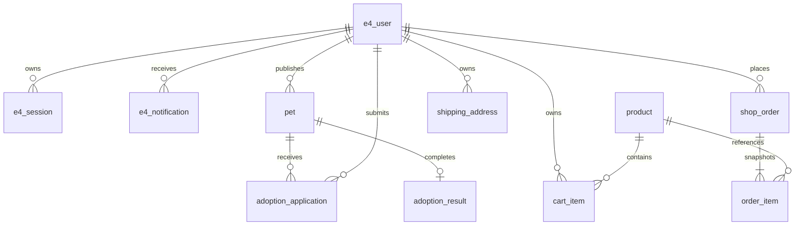

# 数据库与迁移

文档状态：`Done`。

应用使用专用MySQL8数据库`pet_final`，存储引擎为InnoDB，字符集为utf8mb4，时间使用UTC。
迁移V001账号会话，V002通知，V003命令去重，V004领养商城。Offline显式迁移校验SHA-256，启动SchemaGuard核对全部版本。不自动DROP/清空/覆盖已执行迁移。备份与秘密配置留在.local不提交。




## 单文件SQL初始化

根目录`pet_final.sql`提供完整建库、建表与教学数据插入，表结构与下述V001—V004一致，并写入应用启动所需的迁移版本及SHA-256。新环境可直接在MySQL客户端执行`SOURCE pet_final.sql;`，再按README配置连接、构建和启动，无须额外执行迁移或演示数据导入。

脚本创建4个教学账号、6只宠物、14类28件商品及2条虚构地址。公开教学账密见README，不含本地数据库凭据或真实个人信息。演示数据仅在相关表为空时插入，不覆盖已有账号，不删除业务数据。独立临时库导入、重复导入和实际应用登录已验证，结果见`../evidence/database-initialization-check.json`。

## 物理表定义

以下与实际迁移一致，金额BIGINT单位分，UUID使用ascii_bin，业务外键关联统一账号。
```sql
CREATE TABLE schema_version (version INT PRIMARY KEY, checksum CHAR(64) NOT NULL, applied_at DATETIME(3) NOT NULL) ENGINE=InnoDB DEFAULT CHARSET=utf8mb4;
CREATE TABLE e4_user (
 id CHAR(36) CHARACTER SET ascii COLLATE ascii_bin PRIMARY KEY,
 account VARCHAR(16) CHARACTER SET ascii COLLATE ascii_bin NOT NULL UNIQUE,
 password_hash VARCHAR(255) NOT NULL,
 role VARCHAR(5) NOT NULL CHECK(role IN ('USER','ADMIN')),
 status VARCHAR(6) NOT NULL CHECK(status IN ('ACTIVE','FROZEN')),
 nickname VARCHAR(30) NOT NULL, bio VARCHAR(200) NOT NULL DEFAULT '',
 profile_version BIGINT NOT NULL DEFAULT 0 CHECK(profile_version>=0),
 state_version BIGINT NOT NULL DEFAULT 0 CHECK(state_version>=0),
 auth_version BIGINT NOT NULL DEFAULT 0 CHECK(auth_version>=0),
 latest_reason VARCHAR(200), latest_action_at DATETIME(3), created_at DATETIME(3) NOT NULL,
 INDEX(created_at,id)
) ENGINE=InnoDB DEFAULT CHARSET=utf8mb4;
CREATE TABLE e4_session (
 token_hash BINARY(32) PRIMARY KEY,
 user_id CHAR(36) CHARACTER SET ascii COLLATE ascii_bin NOT NULL,
 auth_version BIGINT NOT NULL, state_version BIGINT NOT NULL,
 expires_at DATETIME(3) NOT NULL, revoked_at DATETIME(3),
 FOREIGN KEY(user_id) REFERENCES e4_user(id), INDEX(user_id)
) ENGINE=InnoDB DEFAULT CHARSET=utf8mb4;

CREATE TABLE e4_notification (
 id CHAR(36) CHARACTER SET ascii COLLATE ascii_bin PRIMARY KEY,
 recipient_id CHAR(36) CHARACTER SET ascii COLLATE ascii_bin NOT NULL,
 title VARCHAR(60) NOT NULL, body VARCHAR(500) NOT NULL,
 type VARCHAR(14) NOT NULL CHECK(type IN ('STATUS_CHANGE','ADMIN_MESSAGE')),
 operation_id CHAR(36) CHARACTER SET ascii COLLATE ascii_bin NOT NULL,
 actor_id CHAR(36) CHARACTER SET ascii COLLATE ascii_bin NOT NULL,
 created_at DATETIME(3) NOT NULL, read_at DATETIME(3),
 FOREIGN KEY(recipient_id) REFERENCES e4_user(id), FOREIGN KEY(actor_id) REFERENCES e4_user(id),
 INDEX(recipient_id,created_at,id), INDEX(recipient_id,read_at)
) ENGINE=InnoDB DEFAULT CHARSET=utf8mb4;

CREATE TABLE e4_command (
 actor_id CHAR(36) CHARACTER SET ascii COLLATE ascii_bin NOT NULL,
 operation_id CHAR(36) CHARACTER SET ascii COLLATE ascii_bin NOT NULL,
 action VARCHAR(32) NOT NULL,
 target_id CHAR(36) CHARACTER SET ascii COLLATE ascii_bin NOT NULL,
 payload_hash BINARY(32) NOT NULL,
 result_json JSON NOT NULL,
 created_at DATETIME(3) NOT NULL,
 PRIMARY KEY(actor_id,operation_id),
 FOREIGN KEY(actor_id) REFERENCES e4_user(id),
 FOREIGN KEY(target_id) REFERENCES e4_user(id)
) ENGINE=InnoDB DEFAULT CHARSET=utf8mb4;

CREATE TABLE pet (
 id CHAR(36) CHARACTER SET ascii COLLATE ascii_bin PRIMARY KEY,
 publisher_id CHAR(36) CHARACTER SET ascii COLLATE ascii_bin NOT NULL,
 name VARCHAR(80) NOT NULL, category VARCHAR(3) NOT NULL, province VARCHAR(30) NOT NULL, region VARCHAR(120) NOT NULL, breed VARCHAR(80) NOT NULL,
 description VARCHAR(1000) NOT NULL, image VARCHAR(255) NOT NULL, phone VARCHAR(32) NOT NULL DEFAULT '', wechat VARCHAR(40) NOT NULL DEFAULT '', email VARCHAR(100) NOT NULL DEFAULT '',
 status VARCHAR(16) NOT NULL DEFAULT 'AVAILABLE', created_at DATETIME(3) NOT NULL DEFAULT CURRENT_TIMESTAMP(3),
 FOREIGN KEY(publisher_id) REFERENCES e4_user(id), INDEX(status,created_at)
) ENGINE=InnoDB DEFAULT CHARSET=utf8mb4;
CREATE TABLE adoption_application (
 id CHAR(36) CHARACTER SET ascii COLLATE ascii_bin PRIMARY KEY,
 pet_id CHAR(36) CHARACTER SET ascii COLLATE ascii_bin NOT NULL, applicant_id CHAR(36) CHARACTER SET ascii COLLATE ascii_bin NOT NULL,
 status VARCHAR(16) NOT NULL DEFAULT 'PENDING', publisher_confirmed BOOLEAN NOT NULL DEFAULT FALSE, applicant_confirmed BOOLEAN NOT NULL DEFAULT FALSE,
 created_at DATETIME(3) NOT NULL DEFAULT CURRENT_TIMESTAMP(3),
 FOREIGN KEY(pet_id) REFERENCES pet(id), FOREIGN KEY(applicant_id) REFERENCES e4_user(id), INDEX(pet_id,applicant_id,status)
) ENGINE=InnoDB DEFAULT CHARSET=utf8mb4;
CREATE TABLE adoption_result (
 pet_id CHAR(36) CHARACTER SET ascii COLLATE ascii_bin PRIMARY KEY, application_id CHAR(36) CHARACTER SET ascii COLLATE ascii_bin NOT NULL UNIQUE,
 created_at DATETIME(3) NOT NULL DEFAULT CURRENT_TIMESTAMP(3), FOREIGN KEY(pet_id) REFERENCES pet(id), FOREIGN KEY(application_id) REFERENCES adoption_application(id)
) ENGINE=InnoDB DEFAULT CHARSET=utf8mb4;
CREATE TABLE product (
 id CHAR(36) CHARACTER SET ascii COLLATE ascii_bin PRIMARY KEY, name VARCHAR(100) NOT NULL, category VARCHAR(40) NOT NULL, description VARCHAR(1000) NOT NULL,
 image VARCHAR(255) NOT NULL, price BIGINT NOT NULL CHECK(price>0), stock INT NOT NULL CHECK(stock>=0), listed BOOLEAN NOT NULL DEFAULT FALSE, recommended BOOLEAN NOT NULL DEFAULT FALSE,
 version BIGINT NOT NULL DEFAULT 0, created_at DATETIME(3) NOT NULL DEFAULT CURRENT_TIMESTAMP(3)
) ENGINE=InnoDB DEFAULT CHARSET=utf8mb4;
CREATE TABLE cart_item (
 user_id CHAR(36) CHARACTER SET ascii COLLATE ascii_bin NOT NULL, product_id CHAR(36) CHARACTER SET ascii COLLATE ascii_bin NOT NULL,
 quantity INT NOT NULL CHECK(quantity>0), selected BOOLEAN NOT NULL DEFAULT TRUE,
 PRIMARY KEY(user_id,product_id), FOREIGN KEY(user_id) REFERENCES e4_user(id), FOREIGN KEY(product_id) REFERENCES product(id)
) ENGINE=InnoDB DEFAULT CHARSET=utf8mb4;
CREATE TABLE shipping_address (
 id CHAR(36) CHARACTER SET ascii COLLATE ascii_bin PRIMARY KEY, user_id CHAR(36) CHARACTER SET ascii COLLATE ascii_bin NOT NULL,
 recipient VARCHAR(50) NOT NULL, phone VARCHAR(32) NOT NULL, address VARCHAR(300) NOT NULL, version BIGINT NOT NULL DEFAULT 0,
 FOREIGN KEY(user_id) REFERENCES e4_user(id)
) ENGINE=InnoDB DEFAULT CHARSET=utf8mb4;
CREATE TABLE shop_order (
 id CHAR(36) CHARACTER SET ascii COLLATE ascii_bin PRIMARY KEY, user_id CHAR(36) CHARACTER SET ascii COLLATE ascii_bin NOT NULL,
 operation_id CHAR(36) CHARACTER SET ascii COLLATE ascii_bin NOT NULL, fingerprint CHAR(64) NOT NULL,
 subtotal BIGINT NOT NULL, discount BIGINT NOT NULL, subsidy BIGINT NOT NULL, payable BIGINT NOT NULL,
 recipient VARCHAR(50) NOT NULL, phone VARCHAR(32) NOT NULL, address VARCHAR(300) NOT NULL,
 status VARCHAR(16) NOT NULL DEFAULT 'PENDING', carrier VARCHAR(50), tracking VARCHAR(80),
 created_at DATETIME(3) NOT NULL DEFAULT CURRENT_TIMESTAMP(3), paid_at DATETIME(3),
 FOREIGN KEY(user_id) REFERENCES e4_user(id), UNIQUE(user_id,operation_id), INDEX(user_id,created_at)
) ENGINE=InnoDB DEFAULT CHARSET=utf8mb4;
CREATE TABLE order_item (
 order_id CHAR(36) CHARACTER SET ascii COLLATE ascii_bin NOT NULL, product_id CHAR(36) CHARACTER SET ascii COLLATE ascii_bin NOT NULL,
 name VARCHAR(100) NOT NULL, image VARCHAR(255) NOT NULL, price BIGINT NOT NULL, quantity INT NOT NULL,
 PRIMARY KEY(order_id,product_id), FOREIGN KEY(order_id) REFERENCES shop_order(id), FOREIGN KEY(product_id) REFERENCES product(id)
) ENGINE=InnoDB DEFAULT CHARSET=utf8mb4;

```
